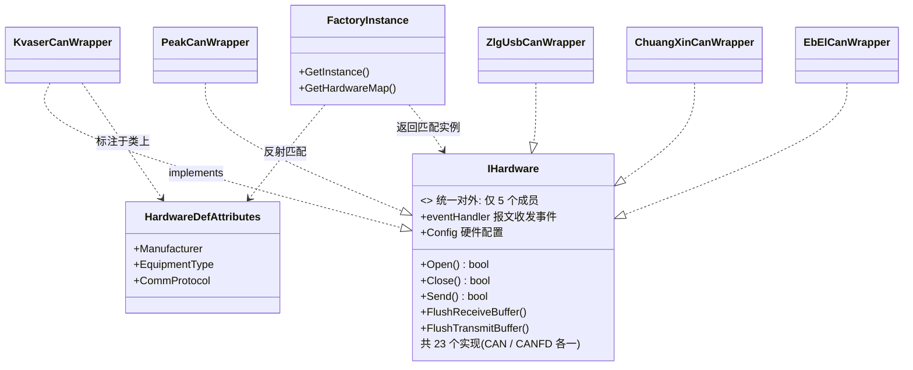
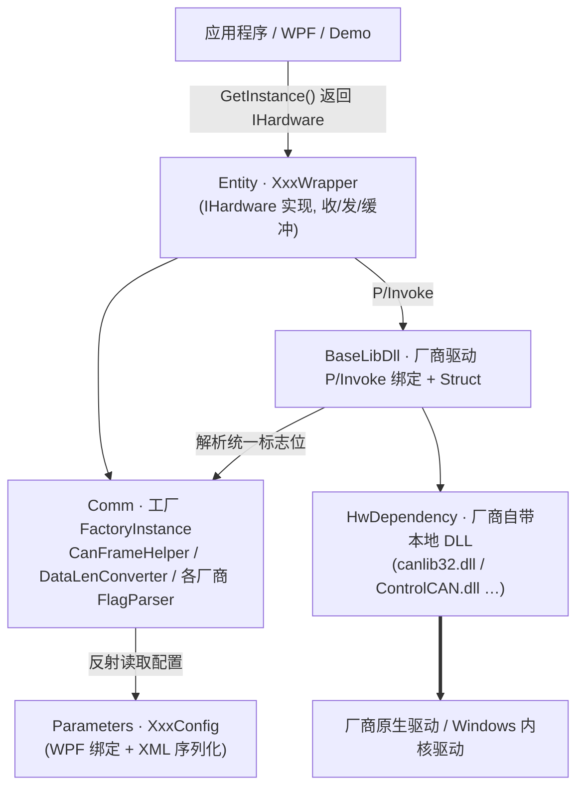
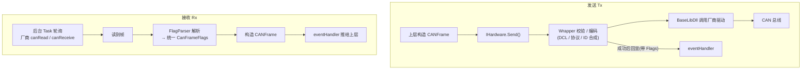

# CAN.Hardware 工程介绍 - Write By DeepSeek V4.1Flash

一个 **基于 .NET 8 的多厂商 CAN / CAN FD 总线硬件抽象库**,通过**统一的接口**屏蔽了不同厂商硬件驱动的差异,让上层应用可以用同一套代码操作来自 12 家厂商的 CAN 设备。

---

## 一、这个工程解决什么问题

在汽车电子、工业控制等领域,CAN 总线是设备通信的主流方式。不同的硬件厂商(Kvaser、周立功、Vector 等)各自提供独立的驱动 API、P/Invoke 调用方式、枚举定义、配置参数和报文标志位,彼此不通用。如果每个项目直接调用厂商驱动,就会出现:

- 换一个厂商的设备,所有收发代码都要重写;
- 不同厂商的波特率、通道、设备型号等配置方式五花八门;
- 接收报文的标志位含义、帧类型判断逻辑各不相同。

**CAN.Hardware 把「厂商驱动的差异性」和「上层业务逻辑」彻底解耦**——上层只面对一套抽象的 `IHardware` 接口,具体用哪家的硬件由工厂根据`厂商 → 设备类型 → 协议`三层枚举自动匹配。

---

## 二、工程结构

### 两个项目

| 项目 | 类型 | 说明 |
|------|------|------|
| [CAN.Hardware](CAN.Hardware/CAN.Hardware.csproj) | classlib (net8.0) | 核心库,所有硬件适配代码,`AllowUnsafeBlocks` 已开启(驱动接口大量用指针) |
| [CAN.Hardware.Demo](CAN.Hardware.Demo/CAN.Hardware.Demo.csproj) | console (Exe) | 演示各厂商经典 CAN 与 CAN FD 的调用方式 |

### 目录分层

```
CAN.Hardware/
├── Attributes/     属性与枚举(不含厂商驱动绑定逻辑,纯声明)
│   ├── HardwareAttributes.cs  特性 HardwareDefAttributes + 厂商↔设备类型映射
│   └── HardwareEnums.cs       厂商、协议、各家设备类型枚举
├── Interface/      统一对外抽象(不依赖任何厂商)
│   ├── IHardware.cs          唯一对外接口(5 个成员)
│   ├── FrameBase.cs          帧基类(ID / Data / Flags)
│   ├── CANFrame.cs           CAN/CAN FD 帧(DLC、FDF、BRS、Dir、Timestamp)
│   ├── CanFrameFlags.cs      统一解析后的标志位
│   ├── BusFrameFlags.cs      标志位基类
│   └── IXmlSerializer.cs     配置序列化接口
├── Model/          配置抽象基类
│   ├── BusConfigBase.cs      各厂商配置的公共基类
│   └── ModeBase.cs           INotifyPropertyChanged 实现(WPF 绑定)
├── Parameters/     各厂商具体配置类(XxxConfig ×24) + XmlAttributeParser 工具
├── Comm/           公共/厂商工具
│   ├── FactoryInstance.cs    硬件实例工厂(反射匹配)
│   ├── CanFrameHelper.cs      ID 解析(区分 EFF/RTR/ERR)
│   ├── DataLenConverter.cs    DLC <=> 长度换算与校验
│   └── Xxx(Can)(Fd)Bitrate.cs / Xxx(Can)(Fd)FlagParser.cs   每厂商波特率与标志解析
├── BaseLibDll/     厂商本地驱动的 P/Invoke 绑定(每厂商一个,只放 Driver + Struct)
│   ├── KvaserCanLibDLL.cs      canlib32.dll
│   ├── ChuangXinCanLibDLL.cs   ControlCAN.dll(VCI_ API)
│   ├── ...共 13 个
└── Entity/         IHardware 的具体实现(XxxWrapper,每厂商 CAN/CANFD 各一个)
    ├── KvaserCanWrapper.cs / KvaserCanFDWrapper.cs
    └── ...共 23 个
```

---

## 三、架构图

### 核心接口关系(UML 简图)



### 依赖分层图



### 报文的两种流向



---

## 四、核心设计

### 1. 统一对外接口 `IHardware`

[CAN.Hardware/Interface/IHardware.cs](CAN.Hardware/Interface/IHardware.cs) 是所有硬件的唯一面向外部接口,只有 5 个成员,极其精简:

```csharp
public interface IHardware
{
    EventHandler<FrameBase>? eventHandler { get; set; } // 报文收发事件(接收和发送都会推送)
    BusConfigBase Config { get; }                       // 硬件配置(支持 WPF Xaml 绑定)
    bool Open();                                        // 打开硬件
    bool Close();                                       // 关闭硬件
    bool Send(FrameBase frame);                         // 发送一帧
    void FlushReceiveBuffer();                          // 清空接收缓冲
    void FlushTransmitBuffer();                         // 清空发送缓冲
}
```

### 2. 三层枚举 + 工厂自动匹配

通过 `HardwareDefAttributes` 特性标注每个硬件封装,用 **厂商 → 设备类型 → 协议** 三层枚举唯一标识一个硬件:

```csharp
[HardwareDefAttributes(HardwareManufacturer.Kvaser, KvaserDeviceType.Generic, CommProtocol.CAN)]
public class KvaserCanWrapper : IHardware { ... }
```

`HardwareDefAttributes` 的构造函数还做了一层**强校验**:某厂商的设备类型必须用该厂商自己的枚举(通过 `EquipmentTypeMap` 映射表检查),用错枚举直接抛异常,从源头杜绝配置错乱。

调用方用 [FactoryInstance.GetInstance](CAN.Hardware/Comm/FactoryInstance.cs) 一行拿到对应实例:

```csharp
var hardware = FactoryInstance.GetInstance(
    HardwareManufacturer.Kvaser,   // 厂商
    KvaserDeviceType.Generic,      // 设备类型
    CommProtocol.CAN);             // 协议: CAN / CANFD / LIN
```

途中用反射枚举当前程序集里所有 `IHardware` 实现,按三个枚举匹配并创建实例(`nonPublic:true` 兼容未来改成 internal 的 Wrapper)。`GetHardwareMap()` 能列出当前已注册的全部硬件清单(厂商→设备类型→协议集合)。

### 3. 报文帧的抽象与解析

- [FrameBase](CAN.Hardware/Interface/FrameBase.cs):所有总线帧的基类,含 `ID`、`Data`、`Flags`。`Flags` 用 `internal set`,只允许驱动侧写入。
- **CANFrame**:具体帧,CAN/CAN FD 通用,含 `DLC`、`FDF`(FD帧)、`BRS`(比特率切换)、`Dir`(0=TX,1=RX)、`Timestamp`(微秒)、`RawFlags` 等。
- **CanFrameFlags**:解析后的统一标志位,把不同厂商的原始标志收拢成一套语义清晰、跨厂商一致的布尔属性,如 `IsRTR`、`IsStandardFrame`、`IsExtendedFrame`、`IsCanFd`、`HasBrs`、`HasEsi`,以及各类错误标志`HasCrcError`/`HasBitError`/`HasOverrun` 等。附带 `ToString()` 生成人性化描述(如 `0x... [STD | FDF | BRS]`)。
- **CanFrameHelper / CanFrameDef**:从原始 ID 中解析扩展帧、RTR、错误帧,并剥离出真实 ID 位(`0x1FFFFFFF`)。ID 采用 **SocketCAN 风格**——把 EFF(0x80000000)、RTR(0x40000000) 等标志合成到 ID 高位。
- **DataLenConverter**:DLC 编码 ⇄ 实际数据长度的换算。经典 CAN 限 0~8 字节;CAN FD 只允许 `0,1,…,8,12,16,20,24,32,48,64` 这些离散值,并提供合法性校验(`IsValidCanLength` / `IsValidCanFdLength`)。

### 4. 配置设计

每个厂商一套配置类(`XxxConfig`,经典 CAN 与 CAN FD 分开,共 24 个),继承 `BusConfigBase → ModeBase`,同时实现 `IXmlSerializer`:

- **面向 WPF**:每个属性带 `[Description]`、通过 `ModeBase.SetProperty()` 触发属性改变通知(`INotifyPropertyChanged`),可直接给界面绑定。
- **面向持久化**:实现 `Init(XElement)` / `ToXElement()`,由 [Parameters/XmlAttributeParser.cs](CAN.Hardware/Parameters/XmlAttributeParser.cs) 完成属性与 XML 属性的互转,方便配置保存与加载。

> 这也说明该库不止于命令行 Demo 使用,**它是个面向 GUI 工具(如 WPF 测试上位机)的底层硬件层**。

---

## 五、使用方法

### 1. 引入项目

把 `CAN.Hardware` 作为项目引用加入你的解决方案,或在 csproj 里加 `<ProjectReference>`。编译后 `HwDependency/` 下的厂商 DLL 会随输出目录一起复制出来。

### 2. 三步走:取实例 → 配参数 → 订阅/收发

以 Kvaser 经典 CAN 为例:

```csharp
using CAN.Hardware.Attributes;
using CAN.Hardware.Interface;
using CAN.Hardware.Comm;
using CAN.Hardware.Parameters;

// ① 工厂按三层枚举取实例
IHardware? kvaser = FactoryInstance.GetInstance(
    HardwareManufacturer.Kvaser,         // 厂商
    KvaserDeviceType.Generic,            // 设备类型
    CommProtocol.CAN);                   // 协议:CAN / CANFD / LIN

// ② Config 返回 BusConfigBase,强转成具体配置类型后设参
var config = (KvaserCANConfig)kvaser.Config;
config.CanDeviceChannel = 0;                          // 通道号
config.CanBitrate      = KvaserCanBitrate.canBITRATE_500K;  // 波特率 500K

// ③ 订阅报文(接收与发送回显都会推到这里)
kvaser.eventHandler += (s, e) =>
{
    if (e is CANFrame f)
        Console.WriteLine($"{(f.Dir == 0 ? "TX" : "RX")} 0x{f.ID:X3} DLC={f.DLC} {f.Flags}");
};

// ④ 打开 → 发送 → 关闭
kvaser.Open();
var frame = new CANFrame
{
    ID     = 0x123,
    DLC    = 8,
    Data   = new byte[] { 0x11, 0x22, 0x33, 0x44, 0x55, 0x66, 0x77, 0x88 },
};
kvaser.Send(frame);
kvaser.Close();
```

### 3. CAN FD 与经典 CAN 的差异

CAN FD 用法几乎一致,只有三点不同:

| 项 | 经典 CAN | CAN FD |
|----|----------|--------|
| 协议枚举 | `CommProtocol.CAN` | `CommProtocol.CANFD` |
| 配置类型 | `XxxCANConfig`(单一波特率) | `XxxCanFDConfig`(仲裁段 + 数据段双波特率) |
| 发送的帧 | 普通帧 | `FDF = true, BRS = true`,数据可达 64 字节 |

```csharp
var config = (KvaserCanFDConfig)kvaserFd.Config;
config.CanFdArbitrationBitrate = KvaserCanBitrate.canBITRATE_500K;   // 仲裁段 500K
config.CanFdDataBitrate        = KvaserCanFdBitrate.canFD_BITRATE_2M_80P; // 数据段 2M

var fd = new CANFrame { ID = 0x123, DLC = 64, FDF = true, BRS = true,
                        Data = Enumerable.Range(0,64).Select(i=>(byte)i).ToArray() };
hardware.Send(fd);
```

### 4. 各厂商标识对照

取实例时,`设备类型`枚举与`配置类型`按厂商对应关系如下(详见 [HardwareEnums.cs](CAN.Hardware/Attributes/HardwareEnums.cs)):

| 厂商 | 设备类型枚举 | 配置类型 |
|------|-------------|----------|
| Kvaser | `KvaserDeviceType.Generic` | KvaserCANConfig / KvaserCanFDConfig |
| Peak | `PeakDeviceType.Generic` | PeakCANConfig / PeakCanFDConfig |
| 同星 Tosun | `TosunDeviceType.Generic` | ToSunCANConfig / ToSunCanFDConfig |
| 周立功 ZLG | `ZlgDeviceType.USBCAN`, `USBCANFD200U` | ZlgCANConfig / ZlgCanFDConfig |
| Vector | `VectorDeviceType.Generic` | VectorCanConfig / VectorCanFDConfig |
| ESD | `EsdDeviceType.Generic` | EsdCANConfig / EsdCanFDConfig |
| NI | `NiDeviceType.Generic` | NiCANConfig / NiCanFDConfig |
| ETAS | `EtasDeviceType.Generic` | EtasCANConfig / EtasCanFDConfig |
| Intrepid 英特佩斯 | `IntrepidDeviceType.Generic` | IntrepidCANConfig / IntrepidCanFDConfig |
| Eberspächer EbEl | `EbElDeviceType.Generic` | EbElCANConfig(**仅 CAN**) |
| 创芯科技 ChuangXin | `ChuangXinDeviceType.USBCAN`, `USBCANFD` | ChuangXinCANConfig / ChuangXinCanFDConfig |
| 图莫斯 Toomoss | `ToomossDeviceType.Generic` | ToomossCANConfig / ToomossCanFDConfig |

完整可运行示例见 [CAN.Hardware.Demo/Program.cs](CAN.Hardware.Demo/Program.cs),覆盖 12 家厂商的经典 CAN 与 CAN FD。**默认只启用了 Kvaser 两个 Demo,其余需安装对应硬件与厂家驱动、去掉注释后才会执行**(见文件顶部注释说明)。

---

## 六、各厂商详细适配说明

工程对每一家厂商都按「**四件套**」适配:`BaseLibDll`(P/Invoke 绑定) + `Comm`(波特率 & 标志解析器) + `Parameters`(配置类) + `Entity`(Wrapper 实现)。各家驱动机制差异很大,下面按**驱动风格**分类说明。已编组代码时按 Kvaser(句柄式)、创芯(批量缓冲式)、EbEl(缓冲式+链表)三种代表性实现梳理。

### A. 句柄式驱动(单帧读写,无自建缓冲协议)

> 代表: **Kvaser、Peak、Vector、ESD、同星 Tosun、NI、Intrepid**

**特征:** `Open` 返回一个通道句柄(handle),之后对句柄做 设波特率 → 启动总线 → 读写。

- **Kvaser** `canlib32.dll`: `canOpenChannel` 返回句柄 → `canSetBusParams`/`canSetBusParamsTq`(支持自定义 TQ 参数)→ `canBusOn` → `canRead`/`canWrite`。特点:
  - 库初始化/卸载用**引用计数**(`InitializeLibrary`/`UnloadLibrary`),整机只装卸一次,多实例共享;
  - `canWrite` 遇 `canERR_TXBUFOFL`(发送缓冲满)自动**重试最多 5 次**,规避 Kvaser 驱动已知 bug;
  - TimeScale 设为 1µs,时间戳单位为微秒;
  - 读线程收到标志经 `KvaserCanFlagParser` → `KvaserMessageFlags`(分段位布局: canMSG_ / canMSGERR_ / canFDMSG_)解析。
- **Peak** `PCANBasic.dll`: 通道是预定义句柄(`PCAN_USBBUS1` 即 0x51),非 0 基连续;波特率枚举即 `pcanBAUD_*`。
- **Vector** `vxlapi64.dll`: 需先指定硬件型号(`VectorHwType.VN1630` 等)和 `XLchannelInfo{HwChannel}`;经典 CAN / CAN FD 各一套 Btl 参数枚举。
- **ESD** `ntcan.dll`: 支持**任意 bps 自定义波特率**(`EnableCustomBitrate` + `CustomBitrate`,驱动自动算位时序);并支持 CAN FD 的仲裁段/数据段分别自定义。
- **同星 Tosun** `libTSCAN.dll / libTSH.dll`: 波特率直接用 **Kbps 数值**(如 500);`CHANNEL_INDEX.CHN1` 选通道。
- **NI** `niXNET (NI-XNET)`: 配置走 session/interface 方式,支持 CAN FD 双段。
- **Intrepid 英特佩斯** `icsneo40.dll`: 通道对应设备高速 CAN 口 `HSCAN1…HSCAN7`;也支持自定义 bps(driver 取最近值)。

### B. 批量缓冲式驱动(一次搬一批帧)

> 代表: **创芯科技 ChuangXin**

**特征:** 驱动自带接收队列,`Open` 时固定 `OpenDevice(devType, devIndex)` + `VCI_InitCAN` + `VCI_StartCAN`,之后**一次 P/Invoke 搬一批帧**。

- **创芯经典 CAN** `ControlCAN.dll`(VCI_ API):`VCI_Receive(…, buf, RxBatchSize, 0)` 一次性最多取 100 帧,再逐个 `Marshal.PtrToStructure` 还原为 `VCI_CAN_OBJ`。关键点:
  - 设备按「设备类型 + 设备索引 + 通道」三维寻址;
  - 波特率由 `BuildTiming` 换算成驱动的 `Timing0/Timing1`;
  - 滤波：`Filter=1` 收全部、`2` 标准帧滤波、`3` 扩展帧滤波;
  - **ID 用创芯原生位(TimeStamp 单位 0.1ms,需 ×100 转 µs)**,再合成 SocketCAN 高位标志;
  - `VCI_Receive` 返回 `0xFFFFFFFF` 表示设备掉线,按无数据处理。
- **创芯 CAN FD** `ControlCANFD.dll`(ZCAN_ API):设备类型枚举单列为 `USBCANFD`(对应 USBCANFD 200U/100U/MINI),用 `UseCanFD=true` 开启 FD 模式,底层库与经典 CAN 完全不同。

### C. 缓冲式发送 + 链表接收

> 代表: **Eberspächer EbEl(Eberspächer Electronics, FlexCard)**

**特征:** `fcbase.dll(flexcard)` 发送是**缓冲式的**——`fcbCANTransmit` 只给「缓冲号 + 数据」,**不带 CAN ID**,报文的 ID/DLC 由预配置的缓冲决定;接收返还一串**链表包**(`fcPacket.pNextPacket`),遍历后需用 `fcFreeMemory` 整链归还。

- **EbEl** `fcbase.dll`:
  - 波特率无数值接口,按**位时序表**查表(`fcCANCcConfig` 的 Prescaler/TS1/TS2 组合)配置,800K 档有特殊时序;
  - `Send` 帧中的 `canFrame.ID` 实际**无法生效**(受缓冲配置限制),RTR 帧不支持;
  - 接收需逐节点遍历链表、`fcCC` 过滤本通道、跳过发送确认帧;
  - **仅经典 CAN,无 CAN FD**——这也是 12 家里唯一没有 FD 适配的一家。
  - 代码注释还指出了原参考实现里「先释放后访问、循环条件写反」等历史 bug,现实现已修正(先整链遍历完再 `FreePacket`)。

### D. 多型号多库驱动(一厂商拆多个枚举/库)

> 代表: **周立功 ZLG、创芯科技**(见上)、**图莫斯 Toomoss**

- **周立功 ZLG** `zlgcan`:设备类型拆 `USBCAN`(经典)与 `USBCANFD200U`(FD);`HwDependency/Zlg/USBCAN/Win/x64/` 下含一整包内核 DLL(CANDevCore、CANDTU、CANFDCOM 等,全部随项目拷贝)。配置含设备型号 `ZlgDeviceModel`、设备索引、通道、以及仲裁/数据双波特率。
- **图莫斯 Toomoss** `USB2XXX.dll`:CAN 与 CAN FD 是**同一设备上的不同协议通路**,共用一套库,设备类型统一 `Generic`;配置里 `DeviceIndex`(USB_ScanDevice 返回序号)、`ChannelIndex`,波特率直接给 bps 值。

### 各家 Comm 工具小结

每家都有 `Comm/{Xxx}{Can|CanFd}Bitrate.cs`(波特率枚举或数值表)与 `{Xxx}{Can|CanFd}FlagParser.cs`(把厂商原生 flag 映射为统一 `CanFrameFlags`)。接收、发送都经各自的 Parser,保证上层读到的是同一套语义。

---

## 七、如何新增一家厂商(扩展指南)

假设要接入新厂商 **Acme**(驱动 `AcmeCAN.dll`)。核心库对厂商的适配收敛在四个目录 + 一个特性映射里,按下面 7 步即可接入,不触碰任何现有厂商代码,也不影响上层调用。

### 第一步:注册厂商与协议枚举

[CAN.Hardware/Attributes/HardwareEnums.cs](CAN.Hardware/Attributes/HardwareEnums.cs):
1. 在 `HardwareManufacturer` 增加 `Acme`;
2. (按需)在 `HardwareEnums.cs` 里新增 `AcmeDeviceType` 枚举——首台设备常用 `Generic`,若设备要拆多型号则列多个值。

### 第二步:登记设备类型↔厂商映射

[CAN.Hardware/Attributes/HardwareAttributes.cs](CAN.Hardware/Attributes/HardwareAttributes.cs) 的 `EquipmentTypeMap` 增加一行:

```csharp
{ HardwareManufacturer.Acme, typeof(AcmeDeviceType) },
```

这样特性构造时的强校验才会放行 Acme 的设备类型枚举。

### 第三步:写 BaseLibDll(P/Invoke 绑定)

新增 `CAN.Hardware/BaseLibDll/AcmeCanLibDLL.cs`:

- 声明需要的 `DllImport`(Open/Close/SetBitrate/Read/Write/Flush…),路径约定为 `HwDependency\Acme\Generic\Win\x64\AcmeCAN.dll`;
- 用 `StructLayout` 还原驱动要求的原生结构体(消息体、配置体等);
- 若驱动要求「整机只初始化/卸载一次」,仿照 Kvaser 加引用计数(`InitializeLibrary`/`UnloadLibrary`,用 `static` + 锁保护);
- 若你的 `Read` 用到指针,记得该 csproj 已开 `AllowUnsafeBlocks`。

### 第四步:放驱动 DLL 并声明拷贝

`HwDependency/` 下照 **厂商/平台/架构** 结构放下 DLL(Acme 若内置多型号,参考 ZLG 的 `kerneldlls` 子目录方式),然后在 [CAN.Hardware.csproj](CAN.Hardware/CAN.Hardware.csproj) 仿照现有 `Content` 条目加一行,把 DLL 打进输出目录:

```xml
<Content Include="HwDependency\Acme\Generic\Win\x64\AcmeCAN.dll">
  <CopyToOutputDirectory>PreserveNewest</CopyToOutputDirectory>
</Content>
```

### 第五步:写 Comm 工具(CAN/CAN FD 各一套,若支持)

新增(经典 CAN 至少,FD 可后补):
- `Comm/AcmeCanBitrate.cs` → `AcmeCanBitrate` 枚举(或数值表);
- `Comm/AcmeCanFlagParser.cs` → 把驱动 `canRead` 返回的 flag(int/uint)解析成统一 `CanFrameFlags`,关键字段务必正确映射 `IsRTR`/`IsExtendedFrame`/`IsCanFd`/`HasBrs`/`HasEsi` 与错误位。
- 支持 CAN FD 时再加 `AcmeCanFdBitrate`(仲裁段+数据段)与 `AcmeCanFdFlagParser`。

`Parsers` 可参考 [KvaserCanFlagParser.cs](CAN.Hardware/Comm/KvaserCanFlagParser.cs) 一种实现:把原生 flag 转成 `[Flags]` 枚举再逐位映射。

### 第六步:写 Config(Parameters)

新增 `Parameters/AcmeCANConfig.cs`(必需)与 `Parameters/AcmeCanFDConfig.cs`(若支持 FD):

```csharp
public class AcmeCANConfig : BusConfigBase, IXmlSerializer
{
    [Description("通道号")]
    public uint AcmeChannel { get; set; }   // 用 SetProperty 触发通知
    public AcmeCanBitrate CanBitrate { get; set; }

    public void Init(XElement x)      { /* 用 XmlAttributeParser.Get 回读 */ }
    public XElement ToXElement(string n) { /* 逐属性写 XAttribute */ }
}
```

每个需要给界面绑定的属性带 `[Description]`,并走 `ModeBase.SetProperty`。

### 第七步:写 Wrapper(Entity)并打特性

新增 `Entity/AcmeCanWrapper.cs`(必需)与 `Entity/AcmeCanFDWrapper.cs`(若支持 FD),实现 `IHardware`,顶部打**三层枚举特性**——这是工厂能识别它的关键:

```csharp
[HardwareDefAttributes(HardwareManufacturer.Acme, AcmeDeviceType.Generic, CommProtocol.CAN)]
public class AcmeCanWrapper : IHardware
{
    private readonly AcmeCANConfig _config = new();
    public BusConfigBase Config => _config;
    public EventHandler<FrameBase>? eventHandler { get; set; }

    public bool Open()   { /* 驱动 Open + 设波特率 + 起总线 + 后台读线程 */ }
    public bool Close()  { /* 停读线程 + 关句柄 + 卸载库(如需要) */ }
    public bool Send(FrameBase frame) { /* 校验 DLC/协议 → 驱动发 → 回显 */ }
    public void FlushReceiveBuffer()  { }
    public void FlushTransmitBuffer() { }
}
```

**Wrapper 规范(保持与现状一致):**
1. **用统一 `object _lock` 锁**串行化所有硬件操作与状态;
2. **后台读线程**用 `Task.Run(ReadTaskProc)` + `CancellationTokenSource`,循环「读到没数据→ `Delay(5ms)`」;`Close` 时先在锁外 `Wait(1000)` 等线程退出,再在锁内释放资源,**避免死锁**;
3. **ID 统一合成 SocketCAN 高位标志**(`CanFrameHelper` / `CanFrameDef`),数据长度用 `DataLenConverter` 校验,`DLC` 钳制到合法范围防越界;
4. **发送强校验**:非法 DLC、在经典 CAN 通道发 FD 帧(FDF/BRS)等一律 `throw`,不静默失败;发送成功后置 `Dir=0` 并经 `eventHandler` 回显;
5. `Open` 中最稳妥的姿势是「**先全部成功再一次性提交字段**,失败则回滚已开资源」——参考创芯/Kvaser 的实现。

### 第八步(可选):写 Demo

在 [CAN.Hardware.Demo/Program.cs](CAN.Hardware.Demo/Program.cs) 仿照 `DemoCan()` 加 `DemoAcmeCan()`(注释掉、标注需硬件与驱动),便于验证。

### 检查清单

| 目录 | 文件 | 是否必须 |
|------|------|----------|
| Attributes/HardwareEnums.cs | `HardwareManufacturer.Acme` + `AcmeDeviceType` | ✅ |
| Attributes/HardwareAttributes.cs | `EquipmentTypeMap` 注册 | ✅ |
| BaseLibDll/ | `AcmeCanLibDLL.cs` | ✅ |
| Comm/ | `AcmeCanBitrate.cs` + `AcmeCanFlagParser.cs` | ✅ |
| Parameters/ | `AcmeCANConfig.cs`(FD 另加) | ✅ |
| Entity/ | `AcmeCanWrapper.cs`(打特性,FD 另加) | ✅ |
| HwDependency/ + csproj | 驱动 DLL + Content 条目 | ✅ |
| Demo/ | `DemoAcmeCan()` | 可选 |

**完成后**你不需要给工厂加任何代码——`FactoryInstance.GetInstance(HardwareManufacturer.Acme, AcmeDeviceType.Generic, CommProtocol.CAN)` 会自动通过反射找到并创建你的 Wrapper。上层调用方式与现有 12 家完全一致。

---

## 八、工程亮点

- **运厂商驱动装进包**:`HwDependency/` 下的原生 DLL 通过 csproj 的 `Content → CopyToOutputDirectory` 打进度,调用方无需手动复制驱动(未尽之家参考 ZLG 整包 `kerneldlls`)。

- **事件驱动收发**:接收由后台 `Task` 轮询驱动队列并回调 `eventHandler`;发送成功也回显,方便统计总线上实际发出的帧。

- **防御性示例**:
  - Kvaser 发送遇 `canERR_TXBUFOFL` 自动重试 ≤5 次(规避驱动已知 bug);
  - `DLC` 钳制到合法范围防越界;非法参数一律显式抛异常,不静默失败;
  - 关闭时在锁外优雅停 `Task` 防止死锁;多通道用统一锁串行化调度;
  - 库装卸用引用计数,多实例共享、整机只装卸一次(Kvaser);
  - 修复了 EbEl 参考实现里「先释放后访问」「循环条件写反」的接收路径 bug。

- **统一标志位**:无论 ZLG 还是 Vector,收到/发出的帧都解析成同一套 `CanFrameFlags`,上层判断逻辑完全一致。

- **可插拔易扩展**:新增第 13 家厂商只需补「四件套 + 特性注册」8 个动作,不动既有代码;出厂时由特性 + 工厂反射自动注册。

---

## 附:目录总览(核心代码文件)

```
CAN.Hardware/
├── Attributes/      HardwareAttributes.cs / HardwareEnums.cs
├── Interface/       IHardware / FrameBase / CANFrame / CanFrameFlags / BusFrameFlags / IXmlSerializer
├── Model/           BusConfigBase / ModeBase
├── Parameters/      XxxConfig ×24 + XmlAttributeParser.cs
├── Comm/            FactoryInstance / CanFrameHelper / DataLenConverter / Xxx*Bitrate / Xxx*FlagParser
├── BaseLibDll/      XxxCanLibDLL.cs ×13(Driver + Struct + DllImport)
├── Entity/          XxxWrapper.cs ×23(IHardware 实现,带特性)
└── HwDependency/    各厂商原生 DLL(Kvaser/Peak/Tosun/Zlg/Vector/ChuangXin/Toomoss)
```
